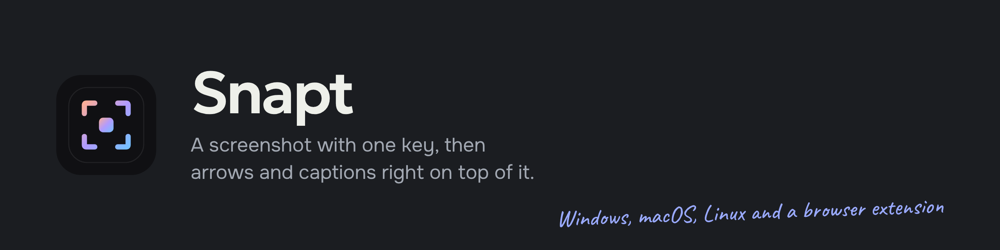

Snapt is a screenshot tool for Windows, macOS and Linux. Press PrtSc, select an area, draw an arrow or type a caption, then copy or save it. It is a small native program: no account, no cloud, and nothing leaves your computer.

**[Website](https://vkardin.github.io/snapt/)** ([RU](https://vkardin.github.io/snapt/ru/), [UA](https://vkardin.github.io/snapt/uk/)) | **[Download](https://vkardin.github.io/snapt/#download)** | **[Firefox extension](https://addons.mozilla.org/firefox/addon/snapt-screenshots-images/)** | **[Report a bug](https://github.com/vkardin/snapt/issues)**

[](https://github.com/vkardin/snapt/releases)
[](https://github.com/vkardin/snapt/actions/workflows/ci.yml)
[](LICENSE)

## What it does

- **Captures** an area, a window or the whole screen on any monitor, with a magnifier for pixel-exact edges.
- **Draws on the shot**: pen, line, arrow, rectangle, ellipse, marker, text and numbered steps. Blur or pixelate what should stay private.
- **Copies, saves or pins** the result. A pinned screenshot stays on top of other windows while you work.
- **Reads text** from the selection with the system's own OCR, in English, Russian, Ukrainian and more.
- **Glues long pages** into one tall image: Snapt scrolls the page by itself.
- **Records** an area as a GIF, or as an MP4 when [ffmpeg](https://ffmpeg.org) is installed.
- **Picks colors** from the screen and copies them as HEX or RGB.

It is written in Rust, starts instantly and sits idle in the tray. If you have used LightShot, you already know how Snapt works. The interface is in English, Russian and Ukrainian, and Snapt updates itself from GitHub Releases.

Planned: Flatpak and code-signed installers.

## Install

Download the installer for your system from the [website](https://vkardin.github.io/snapt/#download) or the [latest release](https://github.com/vkardin/snapt/releases): `.exe` or `.msi` for Windows, `.dmg` for macOS, `.deb` or AppImage for Linux.

Snapt is not code-signed yet. On Windows, click **More info → Run anyway** in the SmartScreen prompt. On macOS, open **System Settings → Privacy & Security** after the first launch attempt and click **Open Anyway**.

## How to use

Press **PrtSc** (**Cmd+Shift+9** on macOS) or pick **Take screenshot** in the tray menu. The screen freezes, then:

| Action | How |
| --- | --- |
| Select an area | Drag with the left mouse button |
| Select a window | Point at it and click |
| Draw | Pick a tool in the panel, or press its key: `A` arrow, `T` text, `R` rectangle, `B` pixelate |
| Undo, redo | `Ctrl+Z`, `Ctrl+Y` |
| Copy to clipboard | `Ctrl+C`, `Enter` or double-click the selection |
| Save to a file | `Ctrl+S` |
| Pin on top of all windows | `F3` |
| Cancel | `Esc` or right-click |

On macOS, use `Cmd` instead of `Ctrl`.

Every key, scrolling screenshots, video, the tray menu, settings, the command line and notes for each platform are in **[docs/USAGE.md](docs/USAGE.md)**.

## Browser extension

Snapt also comes as an extension for Chrome and Firefox: select an area, the visible part or the whole scrolling page, annotate it with the same tools, and copy or save it. It adds "Save image as PNG / JPG" to every image and an Alt+click viewer that zooms down to the pixel grid. Install it from [Firefox Add-ons](https://addons.mozilla.org/firefox/addon/snapt-screenshots-images/). See [extension/README.md](extension/README.md).

## Building from source

You need a recent stable [Rust toolchain](https://rustup.rs).

```sh
git clone https://github.com/vkardin/snapt
cd snapt
cargo run --release
```

On Debian or Ubuntu, install the system libraries first:

```sh
sudo apt install libxcb1-dev libxcb-randr0-dev libxcb-shm0-dev libdbus-1-dev \
  libpipewire-0.3-dev libwayland-dev libegl-dev libgbm-dev clang
```

Set `RUST_LOG=debug` to see detailed logs.

To build the installers for your platform, install
[cargo-packager](https://github.com/crabnebula-dev/cargo-packager) and run:

```sh
cargo install cargo-packager --locked
cargo build --release
cargo packager --release
```

They land in `target/packages`. Pushing a `v*` tag builds them for all platforms in CI
and publishes a GitHub Release.

## Contributing

Bug reports and ideas are welcome in [Issues](https://github.com/vkardin/snapt/issues). See [CONTRIBUTING.md](CONTRIBUTING.md) for how to build, test and send a pull request.

## Support

Snapt is free and has no ads. If it saves you time, you can say thanks on [Ko-fi](https://ko-fi.com/vkardin) or [Donatello](https://donatello.to/vkardin), or with crypto on the [website](https://vkardin.github.io/snapt/#donate).

## License

[MIT](LICENSE) © vkardin

Snapt bundles a subset of the [Inter](https://github.com/rsms/inter) typeface, licensed under the [SIL Open Font License](assets/fonts/OFL.txt).

<!-- project-family:start -->
## More of my programs

All made by one person, free and open source. They live at [vkardin.github.io](https://vkardin.github.io/).

| Program | What it does |
| --- | --- |
| [Video Glow](https://vkardin.github.io/video-glow/) | Soft light around the video that follows the picture, like a backlight behind a TV. |
| [Leveler](https://vkardin.github.io/leveler/) | Evens out the volume in films: you can hear the dialogue and the explosions don't blast. |
| [Video Drift](https://vkardin.github.io/video-drift/) | Video in a small window on top of everything else. Remembers where you stopped. |
| [UNI](https://vkardin.github.io/uni-homebot/) | Your home server at hand: apps, monitoring and notifications in Telegram. |
| [Коли Є](https://vkardin.github.io/koly/) | Power outage schedules for every region of Ukraine, with a countdown until the power is back. |
| [Tukk](https://vkardin.github.io/tukk/) | Shake the phone to turn on the flashlight. Flip it over for silence. In the works. |
<!-- project-family:end -->
